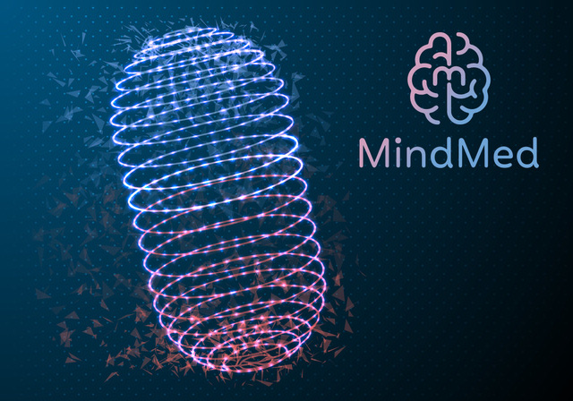
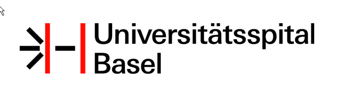
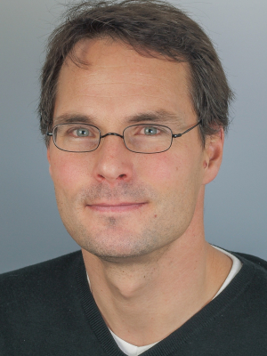

Mind Medicine (MindMed), la farmacéutica psicodélica que lleva ya unos años trabajando en investigación con enteógenos y ecodélicos, acaba de anunciar la inscripción de una nueva patente desarrollada por el investigadores suizos en Liechti Lab, un laboratorio de la misma tónica liderado por Matthias Liechti en el Hospital Universitario de Basilea (de la Universidad del mismo nombre).

En dicha solicitud de patente, MindMed describe de manera literal «**una tecnología neutralizadora, cuyo fin es acortar o detener los efectos de un viaje de LSD en el contexto de una sesión terapéutica**«[^1].

Por supuesto, no se ha hecho público el compuesto en cuestión, pero Liechti ha dicho que tienen «un plan programado cuyo objetivo es explorar el uso de un rango de compuestos a ser utilizados para tratar reacciones negativas, con el claro objetivo de incrementar los niveles de seguridad al usar estas sustancias para fines clínicos y terapéuticos». [^2]

Claramente se hace referencia a la posibilidad de lo que se le llama un «**mal viaje**» o «_bad trip_«, que es sindicado por los usuarios como uno de los efectos adversos posibles en el uso de cualquiera de los psicodélicos clásicos.

Aunque poco comunes, estas experiencias negativas se caracterizan por sentimientos de mucha incomodidad ante el efecto alterado de consciencia, donde el miedo y la inseguridad pueden tomar el volante un poco más de la cuenta.

Quienes experimentan un mal viaje, generalmente quieren precisamente _bajarse de la montaña rusa_, cosa que hasta hoy no es posible, pero que podría cambiar con este avance de MindMed.

El co-fundador y co-CEO de la compañía, JR Rahn, recalcó los potenciales beneficios terapéuticos «no sólo en el polo del usuario, sino del terapeuta».

## Más sobre MindMed

Mind Medicine es una compañía neurofarmacéutica que «descubre, desarrolla y despliega medicinas inspiradas en la psicodelia para mejorar la salud, promover el bienestar y aliviar el sufrimiento», versa su propia web[^3].

Entre sus prioridades máximas está dar respuesta a la crisis mundial ocasionada por los opioides, y buscan «desarrollar una versión no alucinógena de la psicodélica Ibogaína».

Actualmente, **MindMed es una de las pocas compañías que logró los permisos para hacer clinical trials con LSD** en pacientes con déficit atencional/desorden de hiperactividad en adultos [^4]. Hoy van en fase 2 (de 3) y han obtenido prometedores resultados con dosis altas en este tipo de pacientes para tratar la ansiedad producida por los síntomas de dicho desorden.

## Más sobre Lietchi Laboratory

Liechti Lab, liderado por el doctor Matthias Liechti[^5], se encuentra ubicado en el Hospital Universitario de Basilea (de la Universidad del mismo nombre).

Fundada en 1460, la Universidad de Basilea es la más antigua de Suiza. El foco de la investigación de Liechti Labs está en la «farmacología de sustancias psicoactivas in viro y en humanos. **El Laboratorio investiga la farmacoquinética y farmacodinámica del MDMA, LSD y anfetaminas en humanos, incluyendo tests psicológicos, farmacogenéticos e imagenes cerebro funcionales**«.

Stephen Hurst, el otro co-fundador de MindMed, indicó que el norte es «estar siempre en busqueda de medicinas psicodélicas de nueva generación», y que la alianza con Liechti Labs abrirá una nuevo camino en los estudios del LSD y otros psicodélicos»[^6].

[^1]: https://www.mindmed.co/press-releases/psychedelic-pharmaceutical-company-mindmed-develops-lsd-neutralizer-technology-to-shorten-and-stop-lsd-trips
[^2]: “I can say that we have a planned program exploring the use of a range of compounds to be used to treat negative acute experiences with hallucinogens to increase their clinical safe use,” Liechti responded to New Atlas in an email. “Classically, such treatments included benzodiazepines or haloperidol. Ketanserin has so far been used to investigate the mechanism of action of psychedelic substances.” Ketanserin is a compound most recently used by psychedelic researchers in studies to block the subjective and neural effects of LSD. Ketanserin, clinically used as an antihypertensive drug, is thought to disrupt the effects of LSD by blocking serotonin 2A receptors in the brain. [https://newatlas.com/science/lsd-off-switch-mindmed-liechti-psychedelic-science/](https://newatlas.com/science/lsd-off-switch-mindmed-liechti-psychedelic-science/)
[^3]: [https://www.mindmed.co/](https://www.mindmed.co/)
[^4]: [https://www.webmd.com/add-adhd/adhd-adults#1](https://www.webmd.com/add-adhd/adhd-adults#1)
[^5]: [https://biomedizin.unibas.ch/en/research/research-groups/liechti-lab/](https://biomedizin.unibas.ch/en/research/research-groups/liechti-lab/)
[^6]: [https://www.prnewswire.com/news-releases/psychedelic-pharmaceutical-company-mindmed-develops-lsd-neutralizer-technology-to-shorten-and-stop-lsd-trips-301044721.html](https://www.prnewswire.com/news-releases/psychedelic-pharmaceutical-company-mindmed-develops-lsd-neutralizer-technology-to-shorten-and-stop-lsd-trips-301044721.html)
